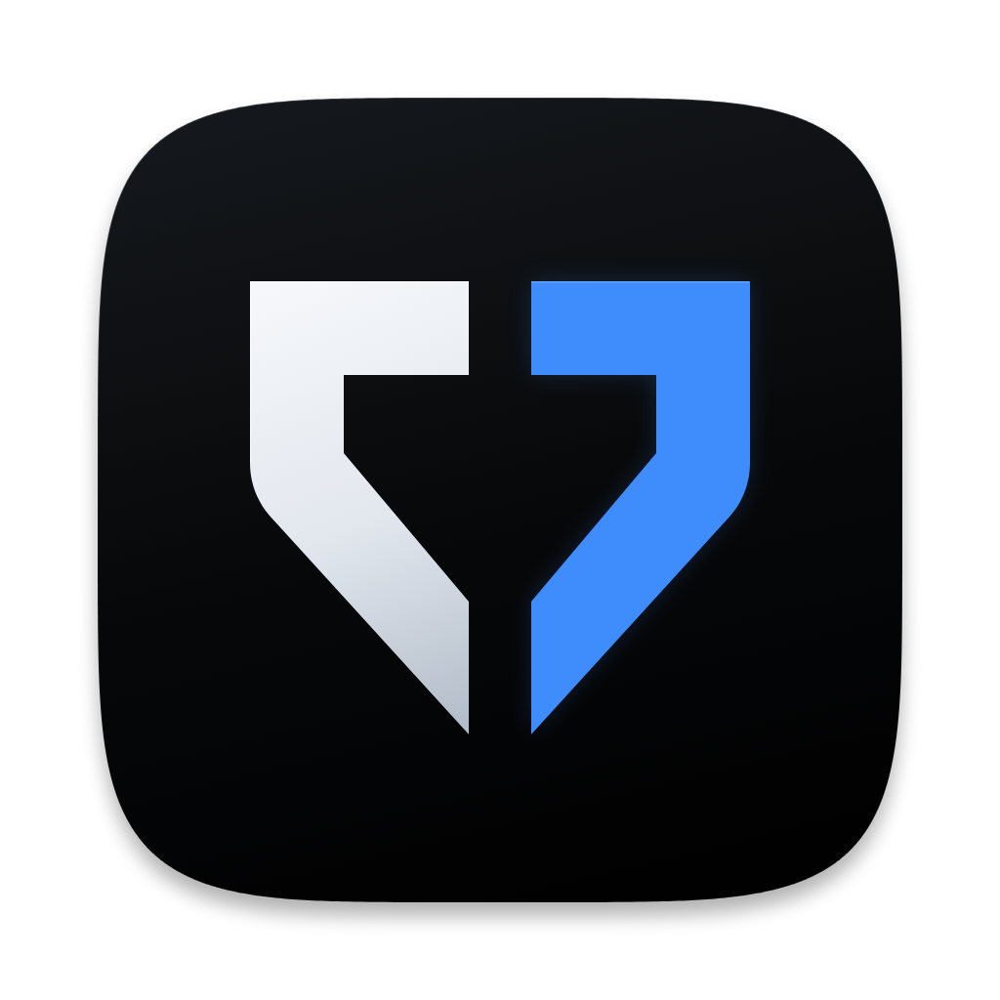
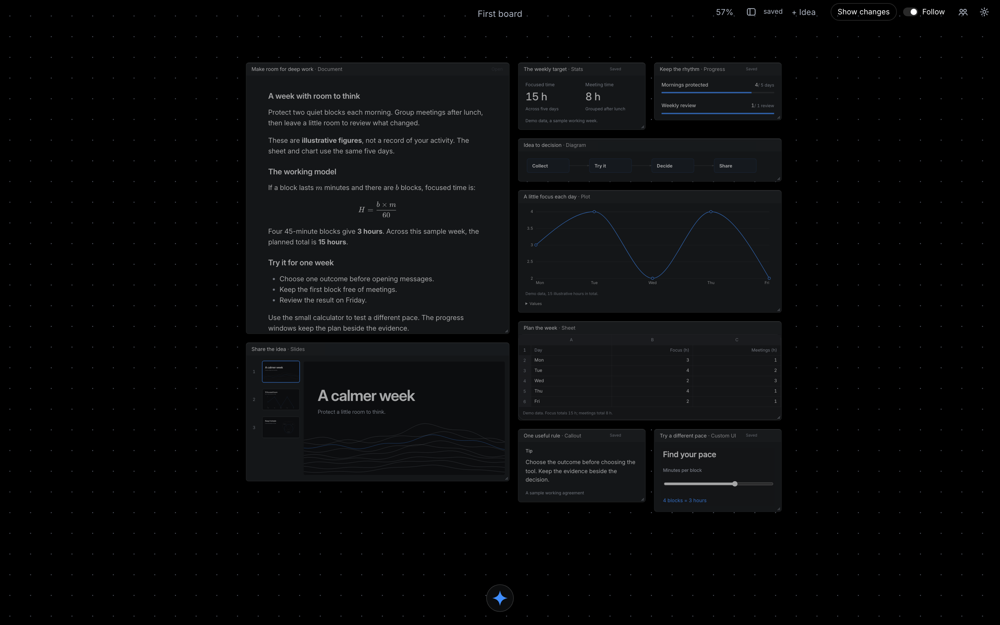

# Aegis

A minimal infinite canvas for you and your agents. Brain-dump into the box at the bottom; agents running on [Pi Durable](https://www.npmjs.com/package/@earendil-works/pi-durable) sort it into groups, checklists and links on the board while you watch.



Agents sign in with your own ChatGPT or Claude subscription (Settings). Boards, sign-in tokens and agent history live in `~/Library/Application Support/Aegis`, never in this repository.

## Run

Needs Rust and Node 22.19 or newer. The repository is one npm workspace with one lockfile.

```sh
npm install
npm run dev        # the app with live UI updates (Vite dev server inside the Tauri window)
npm run build      # Aegis.app in src-tauri/target/release/bundle/macos
npm run check      # safe-type and ownership gate, strict types, lint, unit and agent-host tests (scripted local model, no provider calls)
npm run check:ui   # browser checks for each feature, one after another (needs Playwright with Chromium and WebKit)
npm run bench      # pan and zoom over 5,000 cards in the production React scene
```

The UI checks start their own agent host on a temporary data folder and a Vite server on ports 5181 to 5189. Screenshots and downloads go to `AEGIS_CHECK_OUT`, or `aegis-check` in the temp folder. Set `PLAYWRIGHT=/path/to/playwright/index.mjs` if Node can't find Playwright. `node checks/ui/run.mjs docs draw` runs only those two.

Signed app updates, release setup and rollback are described in [App updates](docs/updates.md).

### The UI updates itself

The window loads `~/Library/Application Support/Aegis/ui/current` when one is installed, otherwise the UI bundled in the app. `POST /ui-update` on the host type-checks and builds `app/`, checks the build, then swaps it in beside the old one (three previous versions are kept). `POST /ui-update/rollback` puts the last one back. `AEGIS_SAFE=1` always loads the bundled UI.

### Use your own Codex or Claude session

Open **Settings > Integrations** to copy a Codex command or TOML configuration,
a Claude Code command, a local Claude
plugin launch command, or a standard MCP configuration for Claude Desktop and
other clients. Keep Aegis open. The session can read imported PDFs and slides,
view source images, draw on the board, make cards and write documents you can
edit in Aegis. Changes appear live in both directions.

See [Local MCP for Codex and Claude](docs/local-mcp.md) for tools, setup and limits.

## Layout

| Path | What |
| --- | --- |
| `packages/domain` | Board schemas, branded IDs and board commands: the only way a board changes, shared by the canvas, the agent tools and the checks |
| `packages/protocol` | Storage and wire codecs between the app, the host and saved files |
| `packages/scene` | The canvas engine: R-tree culling, one transform for pan and zoom, one demand-driven animation frame, leased card shells |
| `packages/host-client` | Effect-based client for the agent host: scoped requests, cancellation, live events and uploads |
| `app/src/workspace` | The client board store: optimistic batches, Undo, save queue and replication |
| `app/src/canvas`, `app/src/cards` | React card bodies rendered into scene leases |
| `app/src/editors` | Document, sheet, deck, dataset and object editors |
| `app/src/chrome` | Boards, library, layers, tools, selection, composer and settings |
| `app/src/charts` | Charts, adapted from Zephium (MPL-2.0) |
| `app/src/features` | Agents, drawing, wireframes, colours, media, imports, editing, onboarding and the phone layout |
| `checks/` | Unit, host, browser, performance and native checks |
| `agent/src/main.ts` (built as `agent/dist/main.js`) | Agent host: Pi Durable, board and object tools, parts (lead and helpers), skills, sign-in, loopback HTTP and live events |
| `agent/skills/` | How to do a kind of job (analyse data, explain a flow and so on); your own skills in the data folder override them |
| `agent/src/ui-update.ts` | Check, build, swap and roll back the installed UI |
| `src-tauri` | Tauri shell: starts the agent host with a per-launch token, stops it on quit, and lets WKWebView render at 120 Hz |

All TypeScript is strict. `npm run check:safe-types` refuses `any`, type assertions other than `as const`, non-null assertions, suppression comments and imports that cross package ownership.

## Credits

Started from [Mochiboard](https://github.com/jessawolfe-ux/mochiboard)'s Tauri setup (MIT, see `LICENSE.mochiboard`). None of Mochiboard's name, character, art, music, fonts or icons are used.

The charts in `app/src/charts/` and parts of the object cards are adapted from [Zephium](https://github.com/zephium-browser/Zephium) at `0eaad6d` under the Mozilla Public License 2.0 (`LICENSE.zephium`). Each such file says so at the top, and those files stay under MPL-2.0. The object kinds, the agent workflow and the skills follow Zephium's Work design, written for Aegis.
