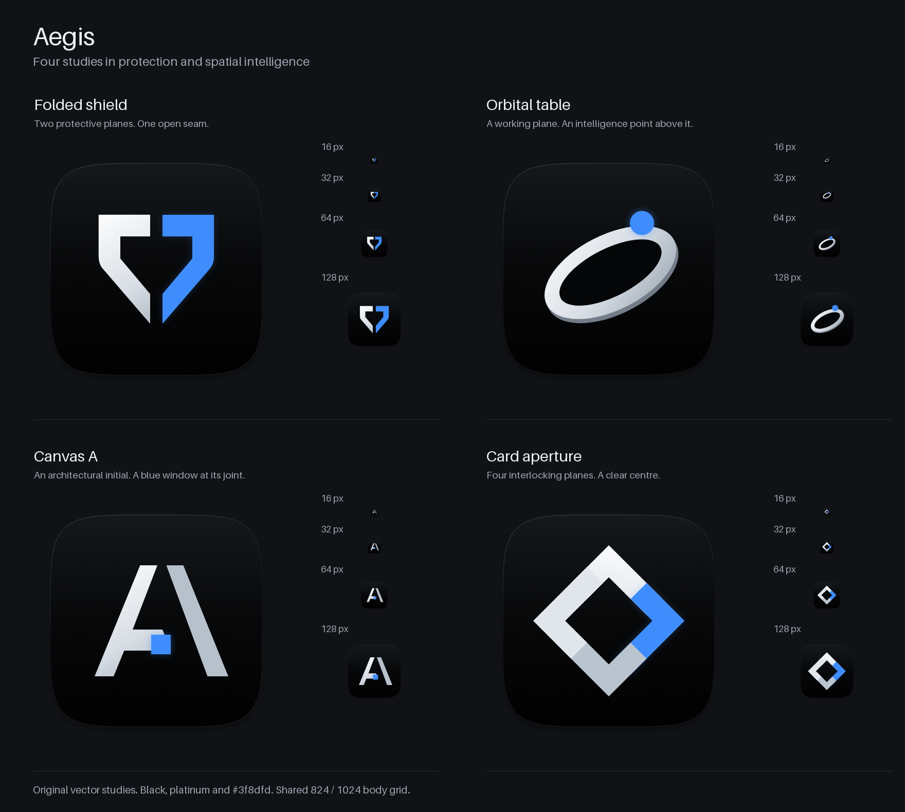

# Aegis identity

The folded shield is Aegis's mark. Two planes hold an open centre: platinum for the user's work, blue for the intelligence helping to shape it. The silhouette carries the name's meaning, protection. Its open seam gives it a recognisable feature at small sizes.

## Four concepts



| Concept | Decision |
| --- | --- |
| [Folded shield](concepts/01-folded-shield.svg) | Chosen. It connects directly to the name and keeps its split silhouette at 16 px. The final mark is larger, with a wider seam. |
| [Orbital table](concepts/02-orbital-table.svg) | Elegant perspective, but it also reads as a planet. |
| [Canvas A](concepts/03-canvas-a.svg) | A clear initial, but the blue window detail becomes secondary at 16 px. |
| [Card aperture](concepts/04-card-aperture.svg) | Strong contrast, but its diamond is less specific to Aegis and its cards merge at small sizes. |

Every concept and the final icon has independent 16, 32, 64, 128, 512 and 1024 px renders in [previews](previews/). See the [final size proof](size-proof.png), [small-size pixels](previews/concept-pixels.png) and [simulated Dock](dock-row.png). The Dock uses plain placeholder squares, with no third-party app artwork.

## Construction and colour

The [master SVG](../../src-tauri/icons/aegis.svg) uses a 1024 x 1024 canvas. Its 824 x 824 body runs from 100 to 924 on both axes, following the requested Big Sur and later grid. Continuous corners come from a Lamé superellipse, sampled at half-degree intervals:

```text
abs((x - 512) / 412)^5 + abs((y - 512) / 412)^5 = 1
```

The shield follows an 8-unit grid, with optical corrections at its shoulders. It spans x = 256 to 768 and y = 288 to 752. Its caps and straight sides are 96 units thick. The 64-unit seam becomes exactly one pixel at 16 px. Both planes stay separate to their lower tips.

| Role | Colour |
| --- | --- |
| Intelligence plane and orb accent | `#3f8dfd` |
| Flat platinum plane | `#f5f7fa` |
| Canvas | `#000000` |
| Dock body lighting | `#14171b` to `#010102` |

The Dock icon adds a fine highlight, soft contact shadow, platinum lighting and restrained blue spill. The [in-app SVG](../../app/src/assets/aegis-mark.svg) keeps the exact silhouette with flat fills and transparency.

## Clear space and the orb

Keep at least 64 master units around the shield, one eighth of its width. The app mark includes this minimum space in its 640-unit view box. Use it at 16 px or larger on dark surfaces. Preserve its proportions and seam.

The mark identifies Aegis. The orb identifies the agent and its activity. Share the blue accent and keep the mark still beside the animated orb, with the same clear space between their visible bounds. Keep the orb outside the shield. The [companion preview](mark-and-orb.png) uses an illustrative blue circle and does not replace the parallel orb redesign.

## Files and rebuild

`src-tauri/icons/` contains the SVG master, five PNG exports, the complete ten-entry `aegis.iconset`, `icon.icns` and seven-frame `icon.ico`. The 1024 px export is `icon.png`. All seven shipping files are listed in `bundle.icon`. The main README displays the icon. The only app source addition is `app/src/assets/aegis-mark.svg`.

This folder holds the concepts, review PNGs and optional 1280 x 640 [social preview](social.png). All icon artwork is original vector geometry, with no stock art, third-party marks or external assets. Review labels use Pillow's bundled font. Icons contain no fonts or text.

Rebuild from the repository root with Python 3, Pillow 12.3, Node, existing Playwright/Chromium and macOS `iconutil`:

```sh
PLAYWRIGHT=/absolute/path/to/playwright/index.mjs python3 docs/brand/build.py
```

The build verifies dimensions, alpha, exact blue, bundle paths, all native frames and shared mark geometry. Eight ICNS entries round-trip exactly. Two legacy entries need premultiplied compiler inputs and differ by at most 2/255 per visible channel on black, grey and white. Source PNGs stay unchanged. Visual review covers all six sizes and the Dock simulation. No native app runtime was tested.
